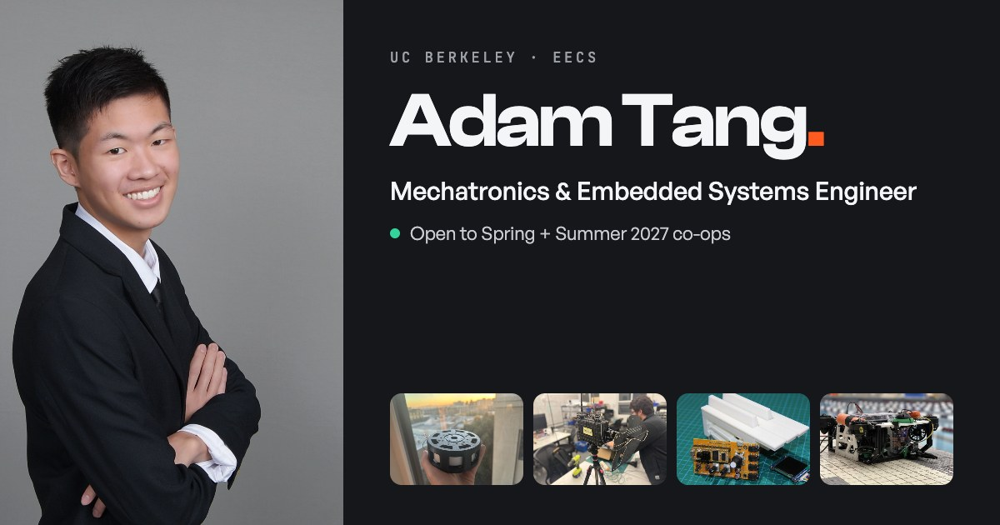

# Adam Tang — Engineering Portfolio

**Live site: [antangled.github.io/engineering_portfolio](https://antangled.github.io/engineering_portfolio/)**



My portfolio: hardware and software I've built, from a cycloidal actuator and a passive-radar node to an underwater ROV and AI tools. Each project page leads with photos and video, then the numbers, what I did, and how it was built.

## Stack

- React 18, TypeScript, Vite
- Tailwind CSS, Framer Motion, Lenis (smooth scroll)
- React Router, deployed to GitHub Pages

All content lives in two files: `src/data/projects.ts` and `src/data/profile.ts`.

## How it's built

- **One template per project.** `ProjectDetail.tsx` renders every project page from data: a photo/video gallery with a lightbox, a key-numbers strip, "what I did", and a short problem → approach → result.
- **Real pages for every route.** `scripts/prerender.mjs` runs after the Vite build and writes a static HTML file per page with its own title and link-preview card, so every URL returns HTTP 200 and previews properly when shared.
- **Accessible by default.** Keyboard-operable lightbox with focus return, reduced-motion support, and WCAG AA contrast across the light and dark themes.

## Run it

```sh
npm install
npm run dev      # http://localhost:5173
npm run build    # dist/, including the prerendered pages
```

Deploy: `npx gh-pages -d dist --dotfiles`.
